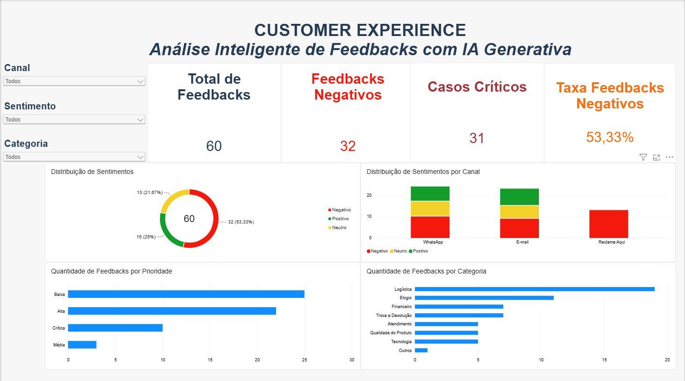

# Atendimento Inteligente de Customer Experience com IA Generativa

## Sobre o projeto

Este projeto demonstra a aplicação de Inteligência Artificial Generativa e Análise de Dados para automatizar a triagem e a interpretação de feedbacks de clientes em um cenário simulado de e-commerce.

A proposta é reduzir o esforço manual das equipes de Customer Experience (CX) na identificação de clientes insatisfeitos, classificação de problemas e priorização de casos que exigem atenção.

A solução utiliza feedbacks simulados provenientes de três canais: WhatsApp, E-mail e Reclame Aqui.

## Objetivos

- Automatizar a classificação de feedbacks utilizando IA Generativa.
- Identificar o sentimento dos clientes: positivo, neutro ou negativo.
- Categorizar os principais motivos dos feedbacks.
- Classificar a prioridade dos atendimentos.
- Identificar possíveis casos críticos.
- Transformar os dados em indicadores e visualizações para apoiar a tomada de decisão.

## Tecnologias e ferramentas utilizadas

- **Google Sheets:** organização e preparação dos dados.
- **SheetGPT:** aplicação de IA Generativa para análise e classificação dos feedbacks.
- **Python:** tratamento, validação e análise exploratória dos dados.
- **Power BI:** construção do dashboard interativo.
- **GitHub:** versionamento e documentação do projeto.

## Etapas do projeto

### 1. Preparação dos dados
Criação de uma base simulada com 60 feedbacks de clientes, contemplando diferentes canais de atendimento.

### 2. Classificação com IA Generativa
Utilização do SheetGPT para gerar as seguintes informações:

- Sentimento do cliente.
- Categoria do feedback.
- Prioridade do atendimento.
- Resumo do feedback.
- Ação sugerida.
- Identificação de caso crítico.

### 3. Análise com Python
Utilização de Python para explorar os dados, calcular indicadores e verificar a qualidade da base, incluindo:

- Verificação de registros duplicados.
- Verificação de valores ausentes.
- Distribuição de sentimentos.
- Distribuição por categorias e prioridades.
- Análise dos feedbacks por canal.
- Identificação e validação da regra de classificação de casos críticos.

## Notebook Python

O notebook apresenta as etapas de tratamento, validação e análise exploratória dos feedbacks de clientes, utilizando Python e Pandas.

Nele são realizadas análises de sentimentos, categorias, prioridades, identificação de casos críticos e geração de indicadores de Customer Experience (CX).

📓 **[Acessar notebook Python](analise_feedbacks_cx.ipynb)**

### 4. Dashboard no Power BI
Desenvolvimento de um painel interativo para acompanhamento dos principais indicadores de Customer Experience, com filtros por canal, sentimento e categoria.

## Principais resultados

A análise dos 60 feedbacks simulados apresentou os seguintes resultados:

| Indicador | Resultado |
|---|---:|
| Total de feedbacks | 60 |
| Feedbacks negativos | 32 |
| Taxa de feedbacks negativos | 53,33% |
| Casos críticos identificados | 31 |
| Taxa de casos críticos | 51,67% |

### Principais categorias identificadas

- Logística: 19 feedbacks.
- Elogio: 11 feedbacks.
- Troca e Devolução: 7 feedbacks.
- Financeiro: 7 feedbacks.
- Atendimento: 5 feedbacks.
- Qualidade do Produto: 5 feedbacks.
- Tecnologia: 5 feedbacks.
- Outros: 1 feedback.

### Análise por canal

O canal Reclame Aqui apresentou 13 feedbacks negativos entre os 13 registros analisados. Já o E-mail apresentou 39,13% de feedbacks negativos e o WhatsApp, 41,67%.

Esse resultado demonstra a importância de analisar os canais separadamente, considerando suas características e o perfil das manifestações recebidas.

## Dashboard

O dashboard permite acompanhar os indicadores de Customer Experience e explorar os feedbacks por diferentes perspectivas.

**Principais recursos:**
- Indicadores de desempenho (KPIs).
- Distribuição de sentimentos.
- Feedbacks por categoria.
- Sentimento por canal.
- Distribuição por prioridade.
- Filtros interativos.

## Aprendizados e próximos passos

O desenvolvimento deste projeto permitiu explorar como a IA Generativa pode apoiar processos de Customer Experience, transformando informações textuais não estruturadas em dados organizados e indicadores para análise.

Como próximos passos, estão previstos:

- Comparação das classificações geradas pela IA com uma base de referência revisada manualmente.
- Avaliação da qualidade das classificações por meio de métricas de desempenho.
- Análise de possíveis erros de categorização.
- Evolução da solução para cenários com maior volume de feedbacks.

## Observação

Este é um projeto demonstrativo, desenvolvido com dados fictícios e simulados para fins de estudo e portfólio. Os resultados apresentados não representam indicadores reais de uma empresa.

---

**Projeto desenvolvido com foco em IA Generativa, Análise de Dados e Customer Experience.**
